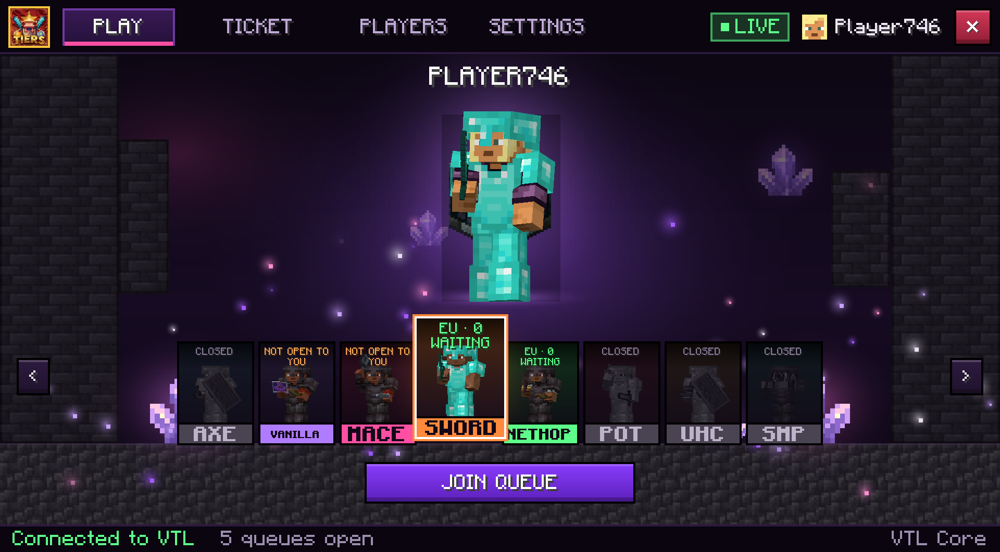
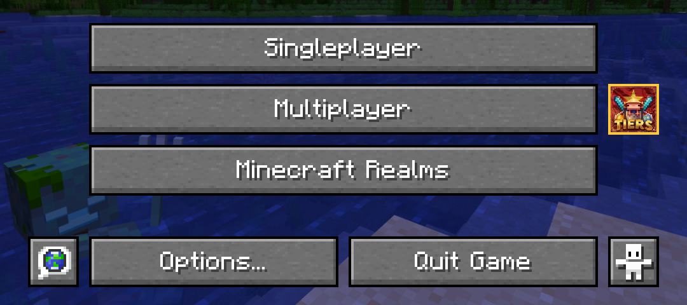
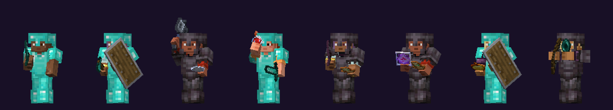
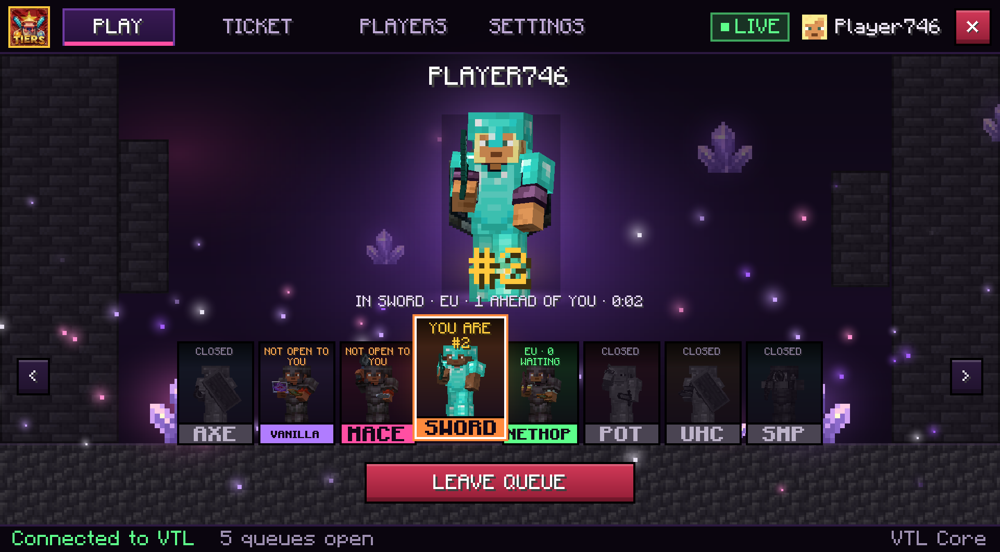
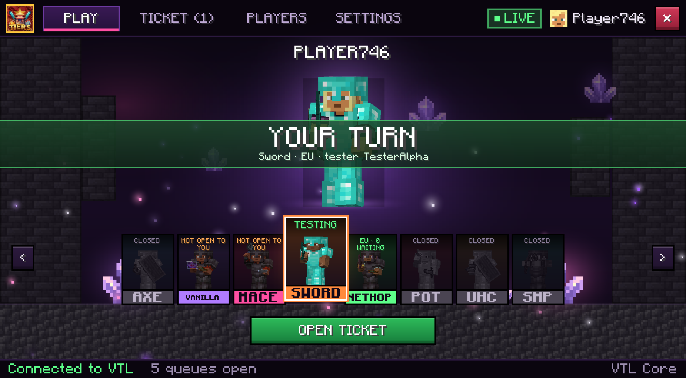
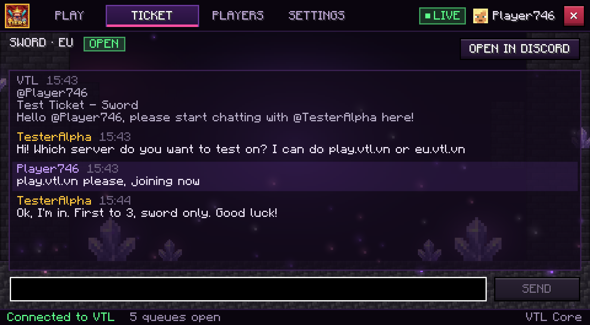
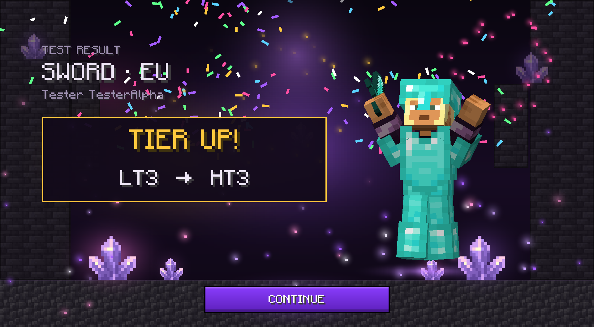
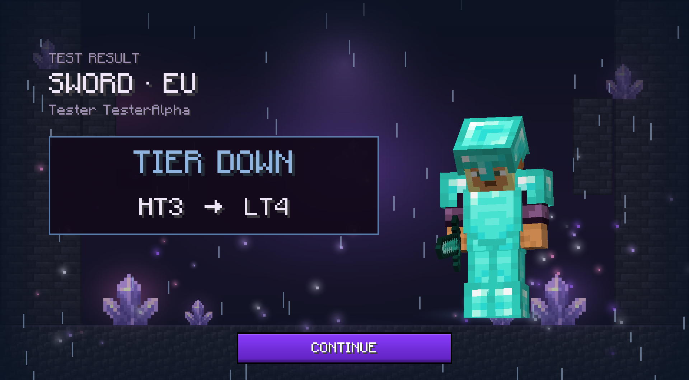
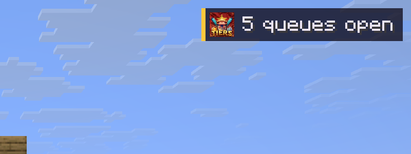
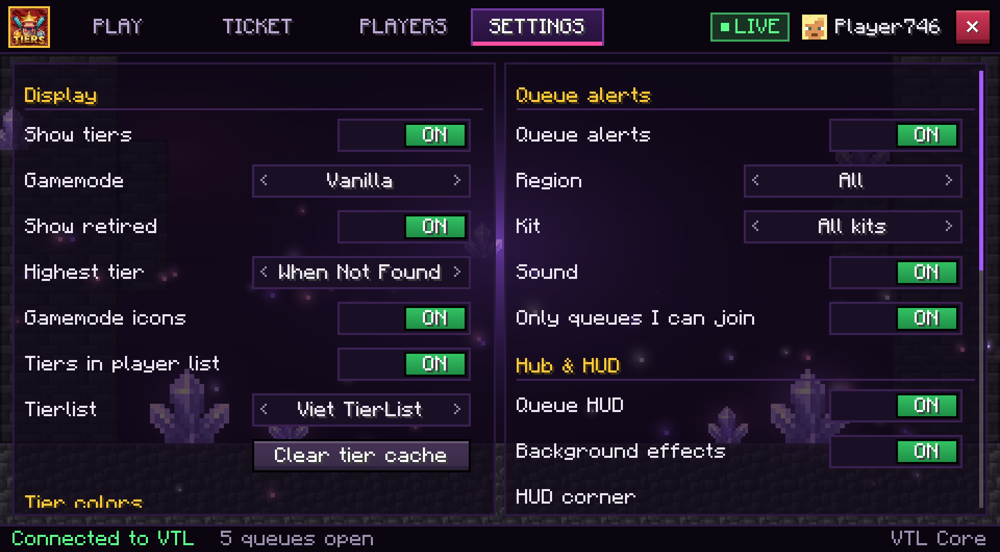

# VTL Core

The client mod of **[Viet TierList](https://www.tierslist.net)**, the Vietnamese Minecraft PvP tier list.
It shows every player's tier above their head, and brings the whole testing flow into the game:
see which queues are open, join one, chat with your tester and watch your result, without
switching to Discord.

**Fabric · Minecraft 1.21.11 · client side only**



## Features

### Tiers on every player
- A tier next to each player's nametag and in the player list (Tab).
- Three tier lists: **Viet TierList**, **MCTiers** and **SubTiers**.
- Choose the gamemode to show, or show the player's highest tier when they have none in it.
- Gamemode icons, retired tiers, and your own tier colours.
- `/vtl <player>` prints all of a player's tiers in chat. The **PLAYERS** tab looks up anyone.

### VTL Hub
Press **R**, type `/vtl`, or click the VTL button next to Multiplayer (also on the pause menu).



The Hub has four tabs: **PLAY**, **TICKET**, **PLAYERS** and **SETTINGS**.

- **One card per kit.** Each card shows whether that queue is open, how many players wait and
  whether you are allowed in.
- **Your own skin in the middle,** wearing the selected kit and holding its guard pose:
  - sword raised;
  - shield up;
  - mace overhead;
  - potion ready;
  - bow drawn.

  Switch cards and the figure swings into the new stance. Drag the figure to turn it.
- **Join and leave queues from the game.** The Discord bot still checks every rule:
  verification, region, waitlist role and cooldowns.
- **Live queue state:** your place, how many are ahead of you, and how long you have waited.



<p>
  
  
</p>

### Ticket chat
When a tester pulls you, your Discord test ticket opens in the **TICKET** tab:
- What you type is posted in the ticket on Discord.
- Everything said there shows up in the game.
- Unread messages are counted on the tab and in the HUD.
- **OPEN IN DISCORD** jumps to the ticket.



### Result screen
When the tester posts your result, the game shows it. The tier spins for a moment (click to skip), then:

| Result | Screen |
|---|---|
| **TIER UP!** / **NEW TIER!** | Fireworks and confetti; your figure cheers, jumps and spins |
| **TIER DOWN** / **NO TIER THIS TIME** | Rain and a cold vignette; your figure hangs its head |
| **TIER KEPT** | The tier you hold |

If another screen is open, a toast tells you to press **R** to see the result.

<p>
  
  
</p>

### Alerts and HUD
- **Chat alerts** when a queue opens, with a clickable **[Join]**.
- **Alert filters:** by region and kit, or only the queues you can join.
- **J** joins the queue from the last alert. It works within 30 seconds of the alert.
- **HUD** in a corner of your choice: open queues, your place in line and unread ticket messages.



### Look and feel
- **Animated Hub background:** floating particles, drifting crystals and pulsing amethyst.
  Turn it off with **SETTINGS → Hub & HUD → Background effects** on slower PCs.
- **3D item icons:** a built-in resource pack based on Block-Accurate 3D Item Models by teyokuma.
  It is off by default.



## Install

1. Install [Fabric Loader](https://fabricmc.net/use/) 0.17 or newer for Minecraft **1.21.11**.
2. Install [Fabric API](https://modrinth.com/mod/fabric-api).
3. Put `VTL-Core+mc1.21.11.jar` in your `mods` folder.
   - Remove any other TierTagger jar: this mod replaces it.
   - [Mod Menu](https://modrinth.com/mod/modmenu) is optional.

Tiers show up right away. To join queues from the game, link your Discord account:
1. Verify on the VTL Discord first (`/verify`), with the Minecraft name you play as.
2. Run `/vtl link`. The bot answers with a 6-character code, valid for 10 minutes.
3. Start Minecraft on the PC you play on, logged in as that verified name, and type `/vtl link <code>`
   (or use **SETTINGS → Discord → Link Discord**).

A link only works for the player who verified:
- **Name:** the game must run the Minecraft account you verified.
- **Premium:** a Premium account is confirmed by Mojang, the same check as joining an online-mode
  server. A cracked launcher cannot link it.
- **Network:** when your network changes, the game is signed out and you link again.
- **One network, one Discord account:** a network links one Discord account at a time.
  Staff can allow a shared network (family, internet café).

## Commands and keys

| Command | Does |
|---|---|
| `/vtl` | Open the Hub |
| `/vtl <player>` | Show a player's tiers |
| `/vtl queues` | List the open queues |
| `/vtl join [kit] [region]` | Join a queue |
| `/vtl leave [kit] [region]` | Leave a queue |
| `/vtl link <code>` / `/vtl unlink` | Link or unlink your Discord account |

In game, `/tiertagger` works as well. On its own, it lists the commands. On Discord the mod's
commands are `/vtl link`, `/vtl unlink` and `/vtl status`.

| Key | Does |
|---|---|
| **R** | Open the Hub (goes straight to the ticket or a waiting result) |
| **J** | Join the queue from the last alert |
| *(unbound)* | Cycle the gamemode shown on nametags |

Change them in **Options → Controls → VTL**.

## What the mod connects to
- **Tier lookups:** only the API of the tier list you picked (`tierslist.net`, `mctiers.com` or
  `subtiers.net`). The mod sends the UUIDs of the players it shows tiers for, and the names you search.
- **Queues:** the VTL gateway, `wss://www.tierslist.net/mod/ws`. Without a link, the mod only
  receives queue alerts.
- **Linking:** gives the game a token, stored in `config/tiertagger-queue-token.txt`.
  - The token lets anyone join queues as you. **Never share that file.**
  - **Unlink** in game or `/vtl unlink` on Discord revokes it.
  - With a Premium session, the game first asks Mojang's session server to confirm it (`joinServer`).
    Your access token goes only to Mojang, never to VTL.
  - The bot keeps a keyed hash of your network to compare later connections, never the IP itself.

The protocol is documented in [`111/MOD-PROTOCOL-v2.md`](111/MOD-PROTOCOL-v2.md).

## Building

You need **JDK 21**.

```bash
./gradlew build
```

The jar is written to `build/libs/`.

On Windows, turn on long paths before cloning, because the bundled 3D item pack has deep folders:

```bash
git config --global core.longpaths true
```

### Testing without the real bot
- [`111/mock-server/`](111/mock-server) runs the same gateway code as the bot, with simulated
  queues, testers and tickets.
- [`TESTING.md`](TESTING.md) covers the rest:
  - headless checks (`./gradlew hubStateCheck`, `queueProtocolCheck`, …);
  - automatic dev-client screenshots;
  - a step-by-step manual test.

### Source layout

| Package (`com.kevin.tiertagger`) | Contents |
|---|---|
| `model`, `tierlist`, `viettierlist` | Tier lists, API clients, tier cache |
| `queue` | WebSocket client, linking, queue and ticket messages, commands, alerts |
| `hub`, `hub/widget` | The VTL Hub screen, its tabs and widgets |
| `hub/anim` | Kit figure: poses, guard stances, result animations |
| `hub/fx` | Background and result particles |
| `hud` | Queue HUD |
| `menu` | VTL buttons on the title and pause menus |
| `config` | Settings (`config/vtl.json`), Mod Menu entry |
| `mixin` | Nametags, player list, title screen, figure poses |
| `dev` | Development-only tools (screenshots, kit art); a released jar ignores them |

## Credits and license

- **Based on TierTagger** by netiyiy (original creator), with work by uku and leoaxo098
  ([Leoaxo098/VTL-TierTagger](https://github.com/Leoaxo098/VTL-TierTagger)). Copyright (c) 2025 MCTiers.
- **3D item icons:** [Block-Accurate 3D Item Models](https://github.com/teyokuma/3D-Item-Models),
  copyright (c) 2024 teyokuma, MIT license. See [`NOTICE.md`](NOTICE.md).
- **License:** [Mozilla Public License 2.0](LICENSE). You may use, change, share and sell the code
  on its terms: keep the notices, and share the source of the MPL files with any build you give out.
- **Name and logo:** "VTL Core", "Viet TierList", "VTL" and the VTL logos are not covered by the
  license. A fork needs its own name and logo. See [`TRADEMARKS.md`](TRADEMARKS.md).
- **Viet TierList services:** the queue, ticket chat and account link talk to the Viet TierList
  servers (the Discord bot and tierslist.net). Those servers are not part of this source and not
  covered by its license. Viet TierList may refuse modified or unofficial clients, and players or
  accounts it has banned.

Not an official Minecraft product. Not approved by or associated with Mojang or Microsoft.
